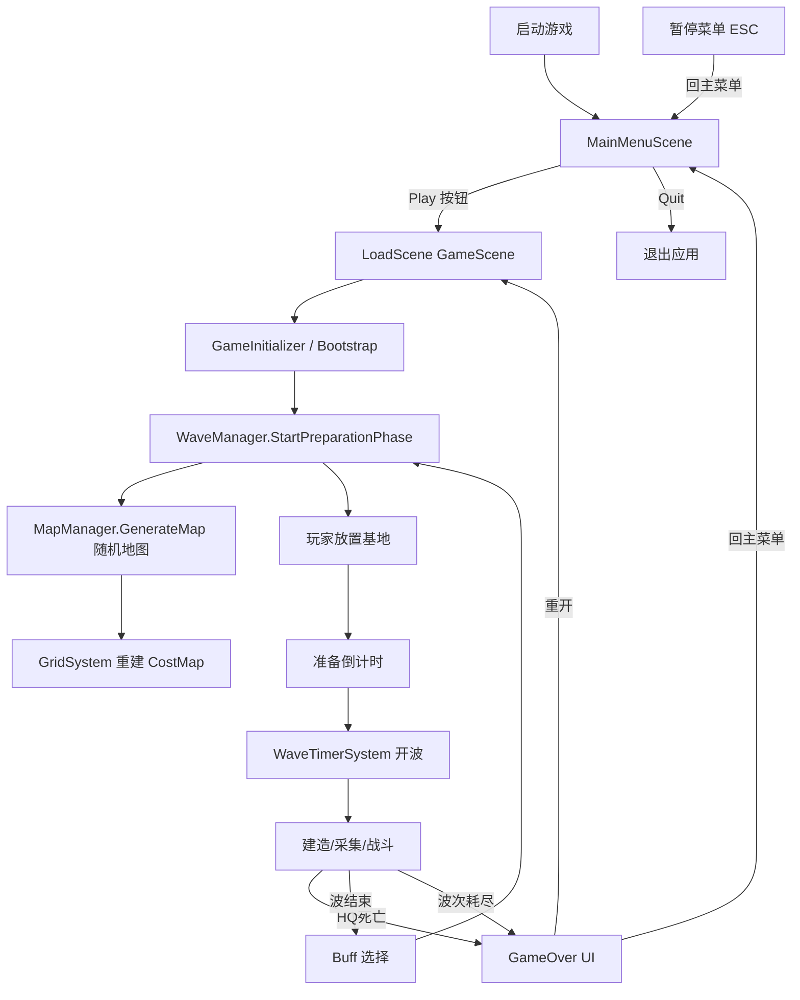

# DotRts 游戏流程缺漏盘点与补全计划（修订版）

> 盘点范围：从主菜单（MainMenuScene）到胜/负再回主菜单的完整可玩闭环。
> 本文件为后续实现依据；按 P0 → P1 → P2 与分阶段 checklist 推进。
> **修订说明（2026-08-06）**：基于全量源码核查，修正了上一版若干与实现不符的判断（波次索引推进点数量、双状态机的实际工作方式、HQ 死亡链路现状），并新增 10 项遗漏缺陷（准备期死锁、timeScale 残留、每波全清场、波次内容锁死、Buff 不继承等）。新增章节见 §9。

---

## 1. 目标与范围

**目标**：理清并补全「主菜单 → 进局 → 随机地图 → 放基地 → 波次循环 → 胜/负 → 回菜单」主流程，使一局可稳定玩通。

**起点**：`MainMenuScene`
**终点**：胜/负 UI 回主菜单，或暂停菜单回主菜单 / 重开 GameScene

**不在本计划优先范围**：完整设置页、音效系统、存档系统、地形高度/生物群系（列入 P2）。

---

## 2. 当前主流程



### 逐步状态（核查后修正）

| 步骤 | 关键 | 状态 | 说明 |
|------|------|------|------|
| 主菜单展示 / Play / Quit | `Ui/MainMenuUi.cs` | 通 | Play → `LoadScene("GameScene")`；Quit → `Application.Quit()` |
| ECS 主菜单逻辑 | `Systems/MainMenuSystems.cs` | 断（空壳） | `OnUpdate` 无逻辑，不影响当前 Mono 菜单 |
| 场景切换进 GameScene | Build Settings + SceneManager | 通 | MainMenuScene、GameScene 在构建列表；GameScene 内含 EntitiesScene 子场景 |
| 场景初始化 | `GameInitializer.cs`、各 Bootstrap | 部分 | 场景里 WaveManager/MapManager 等**均已挂载且序列化引用齐全**；但 GameInitializer 的运行时拼 UI 逻辑未收敛 |
| 随机地图生成 | `MapManager.GenerateMap`（由准备阶段触发） | 通但有副作用 | 每次 `StartPreparationPhase` 都 `GenerateMap` → `ClearMap` 会**销毁全部 RuntimeEntity（HQ/建筑/单位/丧尸）**，见 P0-3 |
| 流场网格 | `GridSystems.cs` | 通 | `needRecalculateCostMap` 链路已接通（MapManager → ECS MapConfigData → GridSystem） |
| 放基地 | Mono `BasePlacementSystem` + ECS `BasePlacementECS` | 通但有死锁风险 | 校验不读 `basePlacementRadius`；场景 `obstacleLayer` 未配置（m_Bits=0）；**ESC 取消放置后无重试路径 → 永久卡准备**，见 P0-4 |
| 准备倒计时 → 开波 | `WaveManager` + `WaveTimerSystem` / `WaveSystem` | 危险接通 | 开波**实际只由 WaveTimerSystem 的 Mono 分支驱动**；ECS 分支因 `isBasePlaced` 无人置位而不可用，见 P0-2 |
| 建造 / 费用 / 施工 | `BuildingPlaceMentMananger` 等 | 通 | 幽灵预览、扣费、施工实体；产物为 RuntimeEntity，会被 ClearMap 清空 |
| 资源采集 | `BuildingHarvestSystem` + `ResrouceManager` | 部分 | 仅建筑收割，无工人 |
| 战斗 / 死亡 | Shoot/Melee/HealthDead | 大体通 | HQ 死亡链路存在（见 P0-7 修正说明） |
| 波结束 → Buff → 下一波 | `BuffSelectionUI` + `WaveManager` | 断点 | 索引存在 **3 处推进点 + 双倒计时双触发**（P0-1）；且再次 `GenerateMap` |
| 通关 | `WaveManager.GameOver()` | 断 | 无独立胜利态，与失败共用 UI |
| 失败 UI / 回菜单 / 重开 | `GameOverUi` / `GameOverUI` / `PauseMenuUi` | 部分 | 双脚本同场景单例竞争；timeScale 残留（P0-5） |

### 关键入口

| 环节 | 路径 |
|------|------|
| 主菜单 | `Assets/Scripts/Ui/MainMenuUi.cs` |
| 进局初始化 | `Assets/Scripts/MonoBehavior/GameInitializer.cs` |
| 波次编排（Mono） | `Assets/Scripts/MonoBehavior/WaveManager.cs` |
| 随机地图 | `Assets/Scripts/MonoBehavior/MapManager.cs` |
| 波次（ECS） | `Assets/Scripts/Systems/WaveTimerSystem.cs`、`WaveSystem.cs`、`WaveSystemBootstrap.cs` |
| 刷怪（波次） | `Assets/Scripts/Systems/ZombieSpawnerSystem.cs` |
| 刷怪（波外，Horde） | `Assets/Scripts/Systems/HordeSpawnerSystem.cs` + `Assets/Scenes/SampleScene/EntitiesScene.unity` 中的 Horde 实例 |
| 回菜单 | `Assets/Scripts/Ui/GameOverUi.cs`、`Assets/Scripts/Ui/PauseMenuUi.cs` |

---

## 3. 子系统完成度

| 子系统 | 完成度 | 关键文件 | 与主流程衔接 |
|--------|--------|----------|--------------|
| 主菜单 / 场景切换 | partial | `Ui/MainMenuUi.cs`，`Systems/MainMenuSystems.cs`（空），场景 Tag Authoring | Play 进局通；ECS 菜单无逻辑 |
| 随机地图 | partial | `MonoBehavior/MapManager.cs`，`MapConfigSo.cs`，`MapConfig.cs`，`Systems/MapConfigSystemBootstrap.cs`，`Components/MapComponents.cs`，`Systems/GridSystems.cs` | 场景引用 `New Map Config So.asset`（100×100、50 障碍、10 资源）可用；`spawnAreaRadius=80 / basePlacementRadius=100` 未消费；`obstacleLayer` 场景值为 0 导致重叠校验失效；每波重随并清场 |
| 基地放置 | partial | `MonoBehavior/BasePlacementSystem.cs`，`Systems/BasePlacementSystem.cs` | 点击放置 HQ 通（经 `PlaceBaseRequest` → ECS `BasePlacementECS`）；半径配置未用；无幽灵预览；ESC 取消即死锁 |
| 资源库存 / 采集 | partial | `MonoBehavior/ResrouceManager.cs`，`Systems/BuildingHarvestSystem.cs`，`Ui/ResrouceManagerUi.cs` | 建筑贴资源点收割；无工人；开局送资源 |
| 建造 | complete（玩法级） | `MonoBehavior/BuildingPlaceMentMananger.cs`，`Systems/BuildingConstructionSystems.cs`，`Ui/BuildingPlaceMentManagerUi.cs` | 预览、扣费、施工、重建 CostMap；**产物带 RuntimeEntity，每波清场时被销毁** |
| 单位 / AI | partial | `UnitSelectionManager.cs`，`UnityMoveSystem.cs`，`FindTargetSystem.cs`，`BarrackSystem.cs`，`RandomWalkingSystem.cs` | 兵营产兵 + 框选移动 + 寻敌；无工人 |
| 战斗 / 死亡 | partial | `ShootAttackSystem.cs`，`MeleeAttackSystem.cs`，`HealthDeadSystem.cs`，`ResetEventsSystems.cs` | 伤害与销毁通；HQ 死亡事件链路存在（依赖 LateSimulation 组内顺序与 DotsEventsManager 挂载） |
| 丧尸 / 波次 | partial | `WaveManager.cs`，`WaveSystem.cs`，`WaveTimerSystem.cs`，`ZombieSpawnerSystem.cs`，`HordeSpawnerSystem.cs` | 能刷怪但**多刷怪源并存**：波次请求 + Horde（子场景 10s 后刷 30 只，不受波门控）；倍率/Boss 在 ECS 侧丢失 |
| 失败条件 | partial | HQ `onDead` → `ResetEventsSystem` → `DotsEventsManager` → `GameOverUi` | 链路存在但脆（顺序/依赖）；无独立胜利分支 |
| 胜利条件 | stub | `WaveManager` 波次耗尽走 `GameOver()` | 无 Victory UI/状态 |
| 波次 / Buff UI | partial | `Ui/WaveManagerUi.cs`，`Ui/BuffSelectionUI.cs` | WaveManagerUi 只显示波次号/剩余时间；击杀显示无来源（场景缺 `WaveKillListener`）；Buff 确认触发 `ConfirmBuffSelectionAndNextWave` |
| 胜负 UI | partial | `Ui/GameOverUi.cs`，`MonoBehavior/GameOverUI.cs` | **两个脚本同时挂在 GameScene**，单例竞争（Awake 顺序决定谁被销毁）；失败/通关混用；timeScale=0 残留 |
| 相机 | complete | `MonoBehavior/CameraController.cs` | 无地图边界钳制 |
| 暂停 | partial | `Ui/PauseMenuUi.cs` | ESC、`timeScale`、回主菜单（回菜单前会恢复 timeScale=1） |
| 设置 / 音效 / 存档 | stub | — | 无玩法级实现 |

---

## 4. 缺漏清单

### P0 — 阻塞 / 严重破坏主流程

1. **波次索引三处推进 + 双倒计时双触发**（原「索引双增」修正）
   - 推进点 ① `WaveManager.EndCurrentWave()` 内 `currentWaveIndex++`；推进点 ② `ConfirmBuffSelectionAndNextWave()` 内 `currentWaveIndex++` 后再 `StartPreparationPhase`；推进点 ③ ECS `WaveSystem` 波结束分支 `waveState.currentWaveIndex++`（与 Mono 索引**不同步**）。
   - 双倒计时：Mono `WaveManager.Update`（`waveTimer -= Time.deltaTime`）与 ECS `WaveSystem`（`waveState.waveTimer -= dt`）**各自倒计时，谁先到 0 谁调 `EndCurrentWave()`**，一次波结束可能触发两次 `EndCurrentWave`，叠加 ①② 使索引跳号或提前判负。
   - 文件：`WaveManager.cs`、`WaveSystem.cs`、`BuffSelectionUI.cs`
   - 建议：单一权威单点推进；Buff 确认只负责开下一准备期；`EndCurrentWave` 加幂等保护。

2. **WaveManager 与 ECS Wave 双状态机，且 ECS 分支实际不工作**（原 P0-2 修正）
   - `WaveTimerSystem` 在 `WaveManager.Instance != null` 时**只读 Mono 状态**（`isBasePlaced` / `preparationTimer`）；其「ECS 自推进」分支依赖 `waveState.isBasePlaced`，但**没有任何代码把它置 true**（Mono 分支里写的是从 WaveManager 读的值，只有走 Mono 分支才会被赋值）→ ECS 分支是死代码。
   - 结论：现状**开波完全依赖 Mono WaveManager**；「以 ECS WaveState 为权威」的建议需先打通 `isBasePlaced` 反馈（BasePlacementECS 放置 HQ 后回写），否则不可行。
   - 文件：`WaveTimerSystem.cs`、`WaveSystem.cs`、`ResetBasePlacementSystem.cs`、`Components/WaveComponents.cs`

3. **每波重随地图 = 全清场**（原 P1-1 升级）
   - `StartPreparationPhase()` 每次 `GenerateMap(seed)` → `MapManager.ClearMap()` 销毁**全部 `RuntimeEntity`**（HQ、所有已建建筑、兵营产出的单位、场上丧尸、射击光效——见 `MapManager.ClearMap` 的 `RuntimeEntity` 查询销毁，`RuntimeEntity` 加在 BasePlacementECS/BuildingConstructionSystems/ZombieSpawnerSystem/ShootLightSpawnSystem 等所有运行时产物上）。
   - 后果：不只「重放基地」，**玩家全部建造进度与场上状态每波归零**。
   - 文件：`WaveManager.cs`、`MapManager.cs`
   - 建议：仅首局生成地图 + 首次放基地；后续波只重置波次计时/刷怪状态（配合 P0-4 补清怪逻辑）。

4. **准备阶段死锁**（新增）
   - `BasePlacementSystem` 允许 ESC 取消放置（`CancelPlacement`），取消后 `isPlacingBase=false` 且**无人再调 `StartBasePlacement`**；`WaveManager` 的 `isBasePlaced` 恒 false → 准备计时永不启动（`Update` 中 `isPreparationPhase && isBasePlaced` 才倒计时），ECS 侧同样等待 → **游戏永久卡在准备阶段**。
   - 同样：`StartPreparationPhase` 中 basePlacementSystem 与 `BasePlacementSystem.Instance` 均为 null 时只打错误日志，随后仍进入等待。
   - 文件：`MonoBehavior/BasePlacementSystem.cs`、`WaveManager.cs`
   - 建议：取消/失败时重新进入放置（或自动放置兜底）；加准备超时自动开始。

5. **timeScale 残留**（新增）
   - `GameOverUi.Show()`、`BuffSelectionUI.ShowBuffSelection()`、`PauseMenuUi.PauseGame()` 都设 `Time.timeScale = 0`；恢复路径只在「暂停菜单继续/退出」与「Buff 选择完成」有 `=1`。
   - **GameOver → 回主菜单 / 重新开始**不恢复 timeScale：场景重载不重置 timeScale → 重开后 `Time.deltaTime=0`、FixedUpdate 停摆，游戏冻结。
   - 文件：`Ui/GameOverUi.cs`、`Ui/BuffSelectionUI.cs`、`Ui/PauseMenuUi.cs`、`MonoBehavior/GameOverUI.cs`
   - 建议：`GameInitializer`/`WaveManager.Start` 统一 `Time.timeScale = 1`；胜负 UI 出口显式恢复。

6. **无独立胜利条件**（原 P0-3）
   - 打完所有波调 `GameOver()`，与失败同一套 UI/事件/文案；`StartPreparationPhase` 里 `currentWaveIndex >= waves.Length` 也走 `OnGameOver`。
   - 文件：`WaveManager.cs`、`GameOverUI.cs`、`Ui/GameOverUi.cs`
   - 建议：增加 Victory 分支与独立文案/面板；胜/负均可回主菜单或重开。

7. **HQ 死亡链路现状核查**（原 P0-4 修正）
   - 链路实际存在：`HealthDeadSystem`（LateSimulation）对 `health<=0` 置 `onDead=true` + `ecb.DestroyEntity`（EndSimulation ECB，帧末播放）→ `ResetEventsSystem`（LateSimulation 组 `OrderLast`）在销毁前读到 `onDead` → `TriggerOnHQDead` → `GameOverUi`。
   - 真正风险点：① 依赖同帧组内顺序（HealthDeadSystem → ResetEventsSystem）；② `ResetEventsSystems.cs` 第 43 行与 `Ui/GameOverUi.cs` 第 43 行对 `DotsEventsManager.Instance` 无 null 保护；③ 场景依赖 `DotsEventsMananger` 对象存在（当前已挂载，勿删）。
   - 文件：`HealthDeadSystem.cs`、`ResetEventsSystems.cs`、`Ui/GameOverUi.cs`

### P1 — 能玩但不完整

1. **波次数据双源不一致 → 波次内容锁死**（原 P1-2 的后果放大）
   - Mono `WaveManager` 用**场景引用** `WaveDataSo`（真实 3 波：300s/10 只、60s/20 只、80s/24 只+Boss）；ECS `WaveSystemBootstrap` 用 `Resources.Load("WaveData")` —— 资产在 `ScriptsableObjects/WaveSo/` **不在 Resources 目录 → 必失败 → fallback 1 波（waveDuration=Infinity, 10 只）**。
   - 后果：`WaveTimerSystem`/`WaveSystem` 从 ECS buffer 取数 → **每波僵尸数恒 10、无倍率、无 Boss**；且 ECS `currentWaveIndex` 只在 WaveSystem 结束分支 ++（fallback 波 Infinity 永不结束 → 该分支不执行）→ 索引长期停在 0。
   - 文件：`WaveSystemBootstrap.cs`、`WaveManager.cs`、`ScriptsableObjects/WaveSo/WaveData.asset`
   - 建议：波次配置单一来源（场景注入并传给 Bootstrap，或资产移入 Resources），缺失时 `Debug.LogError` 明确失败，不得静默 fallback。

2. **波次结束无清怪/回收逻辑**（新增，配合 P0-3 修复后必须落地）
   - 当前「僵尸残留」被每波 ClearMap 掩盖；一旦改为仅首局生成地图，场上未击杀僵尸将累积进下一波，难度爆炸。
   - 建议：波结束时销毁带 `EnemyAttackHQ` 的 RuntimeEntity（或强制引导/统计「剩余僵尸」），并为「全清才过波」或「限时过波」二选一定口径。

3. **Buff 对后续单位无效 + 部分空实现**（新增）
   - `BuffManager.ApplyBuff*` 全是**即时遍历现有实体改数值**：兵营之后产出的新兵/新建筑不带 buff；且每波 ClearMap 销毁实体后 buff 彻底丢失。
   - `ApplyBuffToResourceBuildings`、`ApplyProductionCountBuffToBarracks` 空实现；`BuffSelectionUI` 用 `Time.timeScale` 控制暂停与暂停/胜负 UI 互相踩。
   - 建议：Buff 改为持久全局乘区（ECS singleton 或 `BuffData` 列表），新单位生成时应用；或至少文档声明「只影响当前单位」。

4. **Horde 波外刷怪**（新增）
   - `EntitiesScene` 中 3 个 Horde 实例（示例：startTimer=10s、zombieAmountToSpawn=30、spawnTimerMax=0）由 `HordeSpawnerSystem` 驱动，**无波次门控**，开局 10s 即在准备/第一波期间刷 30 只；`DestroyPreplacedZombiesSystem` 只清无 RuntimeEntity 的预放置僵尸，不影响 Horde 与其产物。
   - 建议：与主波次合并门控（仅波中激活）或按计划阶段 5 评估禁用旁路。

5. **击杀计数无来源**（新增）
   - 场景**未挂载 `WaveKillListener`**（`DotsEventsManager.OnZombieDead` 无监听）→ `WaveManager.ZombiesKilledInCurrentWave` 恒 0；`WaveManagerUi` 也无击杀显示字段。
   - 建议：挂载监听器或改为 ECS 内统计；若走「清怪过波」设计则此为必经数据。

6. **基地/障碍放置校验失效**（原 P1-5 细化）
   - 场景 `MapManager.obstacleLayer` 为 0（Nothing）→ `MapManager.IsPositionValid` 的 `Physics.OverlapSphere(..., obstacleLayer)` 恒无碰撞 → 障碍物可互相重叠；`BasePlacementSystem.IsPlacementValid` 同字段 → **基地可放在障碍物/资源点上**。
   - `basePlacementRadius=100`（配置）与 `spawnAreaRadius=80`（配置）均未消费；WaveSystem 刷怪半径用硬编码 `edgeDistance = min(w,h)*0.4`。
   - 建议：配置 LayerMask 与半径字段并读取；或删除死字段。

7. **GameOver UI 多入口 + 双脚本单例竞争**（原 P1-7 细化）
   - `Ui/GameOverUi.cs` 与 `MonoBehavior/GameOverUI.cs` **同时挂在 GameScene**：`GameOverUi.Awake` 在 `GameOverUI.Instance == null` 时**新建一个无面板引用的临时 GameOverUI**；若它先 Awake，场景内真实 GameOverUI 会因 `Instance` 已存在而 `Destroy(gameObject)` → 面板失灵。另 `GameInitializer.InitializeGameOverUI`（未被调用）、`UIManager`（未挂载）仍留存创建逻辑。
   - 建议：收敛为单一场景预制体 + 单一监听；删除未调用的创建方法。

8. **`StartWaveEvent` / 相关死代码**（原 P1-8）
   - `ResetBasePlacementSystem` 与 `WaveSystem` 处理 `StartWaveEvent`，但全库**无创建方**；`MapSpawnRequest`/`MapClearRequest` 由 Bootstrap 添加并禁用，无人消费。
   - 建议：接上事件管线或删除（若按 P0-1 以 Mono 为权威，删除 ECS 侧 `StartWaveEvent` 分支）。

9. **`TestWaveSystem` 常驻场景**（新增）
   - GameScene 挂载 `TestWaveSystem`（`enableTestMode=true`）：N 键强制 `EndCurrentWave`（跳波）、K 键模拟击杀、R 键重置。调试入口留在正式流程，干扰验收。
   - 建议：移除或默认 `enableTestMode=false`。

10. **主菜单无设置入口；`MainMenuSystems` 空壳**（原 P1-9）

### P2 — 打磨

1. 相机无地图边界钳制 — `CameraController.cs`
2. 无设置页 / 音效 / 存档
3. 地图无高度/生物群系，Terrain 仅为平面
4. `ResetEventsSystems.OnDestroy` 漏 dispose `onHordeStartedSpawningEntityList` / `onHordeStartSpawningSoonEntityList`（新增，NativeList 泄漏）
5. 场景未挂 `ZombieTopUi` / `HordeUi`（新增，Horde 状态无 UI 展示）
6. 建造相关 `Debug.Log` 过多 — `BuildingPlaceMentMananger.cs`
7. 暂停回菜单依赖场景重载清理 ECS World 状态
8. `GameInitializer` 运行时拼 UI 质量差且部分未调用
9. 波次/刷怪链路 `Debug.Log` 过多（`WaveTimerSystem` 的 Error 级别日志刷屏）

### 注释类 TODO

全库 `Assets/Scripts/**/*.cs` 中 **无** `TODO` / `FIXME` / `NotImplemented` 匹配。
隐性未完成以空实现/未消费组件体现（如 `MainMenuSystems`、`StartBuffSelection()` 空方法、`MapSpawnRequest` 未 Enable、`ApplyBuffToResourceBuildings` 空实现）。

---

## 5. 分阶段补全任务

### 阶段 1 — 稳住波次权威与生命周期（P0）

- [ ] 明确单一波次权威：以 Mono `WaveManager` 为唯一推进方，禁用 ECS 侧波结束推进（或先打通 `waveState.isBasePlaced` 再谈 ECS 权威）
- [ ] 修复索引推进：`EndCurrentWave` / `ConfirmBuffSelectionAndNextWave` / ECS `WaveSystem` 只保留一处 `currentWaveIndex++`；`EndCurrentWave` 加幂等保护（`isWaveActive` 守卫）
- [ ] 消除双倒计时：Mono `WaveManager.Update` 与 ECS `WaveSystem` 只留一处递减波时长
- [ ] 理清 `StartWaveEvent`：接上创建方，或删除事件与 `ResetBasePlacementSystem` 死路径
- [ ] 修地图生命周期：`StartPreparationPhase` 仅首局 `GenerateMap` + 首次放基地；后续波保留地图、HQ、建筑与 CostMap
- [ ] **补波次结束清怪/回收**（新增）：波结束时清理场上 `EnemyAttackHQ` RuntimeEntity，防止僵尸累积
- [ ] **准备阶段防死锁**（新增）：ESC 取消后重新进入放置/自动兜底；准备超时自动开波
- [ ] 验收：一局多波手动验证——准备 → 开波 → Buff → 下一波，索引连续不跳号；第二波地图/HQ/建筑保留；波间场上无残留僵尸

### 阶段 2 — 胜负闭环与 UI 收敛（P0）

- [ ] 增加 Victory 状态与 UI 文案（与 GameOver 失败区分）
- [ ] 波次全部完成后走 Victory，而非 `GameOver()`
- [ ] HQ 死亡链路加固：`DotsEventsManager.Instance` 判空；确认 LateSimulation 组内顺序注释说明
- [ ] **timeScale 统一恢复**（新增）：`GameInitializer`/`WaveManager.Start` 强制 `Time.timeScale = 1`；胜负 UI 出口显式恢复
- [ ] 胜/负 UI：回主菜单、重开 GameScene 两条路径均可测通且不冻结
- [ ] 收敛 GameOver/Victory UI 为单一场景入口，**移除 GameOverUi 与 GameOverUI 双脚本单例竞争**（合并为一个脚本与一个面板）
- [ ] 移除或默认禁用场景内 `TestWaveSystem`

### 阶段 3 — 配置注入与波次内容（P1）

- [ ] 波次配置单一来源：`WaveDataSo` 场景注入并传给 ECS Bootstrap（或资产移入 `Resources`）；缺失时 `Debug.LogError` 并可见失败
- [ ] 去掉「找不到配置就静默默认 1 波」的 fallback（至少 fallback 不得把 `waveDuration` 设为 Infinity）
- [ ] 确认 `ScriptsableObjects/WaveSo/WaveData.asset`（3 波 + Boss 波）在进局后被 Mono 与 ECS 使用同一份数据
- [ ] `ZombieSpawnerSystem` 应用 `zombieHealthMultiplier` / `zombieDamageMultiplier`
- [ ] Boss 波使用 `bossPrefab`（或独立配置 Prefab），第三波（specialWaveType=Boss）可感知
- [ ] 特殊波类型至少落地一种可感知差异（或从配置中移除未实现类型）
- [ ] 评估 `HordeSpawnerSystem`：与主波次合并门控，或禁用 EntitiesScene 中 Horde 实例避免波外刷怪

### 阶段 4 — Buff / 击杀 / 刷怪源收敛（P1）

- [ ] Buff 改为持久化全局乘区（或明确「仅对当前单位生效」并同步文档）
- [ ] 补 `ApplyBuffToResourceBuildings` / `ApplyProductionCountBuffToBarracks` 或从 UI 移除对应选项
- [ ] Buff 弹窗暂停与暂停/胜负 timeScale 解耦（改为独立 UI 状态）
- [ ] 击杀计数接入：挂载 `WaveKillListener` 或 ECS 内统计
- [ ] 基地放置校验：配置 `obstacleLayer` 与 `basePlacementRadius` 并实际读取

### 阶段 5 — 打磨（P1/P2）

- [ ] 清理或实现 `MainMenuSystems` 空壳
- [ ] 主菜单保持 Play / Quit 可用；设置入口可延后
- [ ] 相机按地图宽高做边界钳制
- [ ] 修复 `ResetEventsSystems` NativeList 泄漏（补两个 Horde 列表的 dispose）
- [ ] 删除或实现未消费的 `MapSpawnRequest` / `MapClearRequest`
- [ ] 减少建造/波次噪音日志（含 `WaveTimerSystem` 的 Error 级刷屏）
- [ ] （可选）设置 / 音效 / 存档 — 单独开任务，不阻塞主流程闭环

---

## 6. 建议实现顺序（摘要）

1. 统一波次权威 + 修索引 / 双倒计时 / Buff 衔接
2. 首局地图、后续波保留 HQ 与建筑 + 波末清怪 + 准备防死锁
3. Victory + HQ 死亡加固 + timeScale 恢复 + UI 收敛（单脚本）
4. 配置单一来源（波次/地图注入，禁静默 fallback）
5. 倍率 / Boss / 特殊波 + Horde 门控
6. Buff 全局化 + 击杀计数 + 放置校验
7. 主菜单清理与体验打磨

---

## 7. 关键文件索引

```
Assets/Scripts/Ui/MainMenuUi.cs
Assets/Scripts/Systems/MainMenuSystems.cs
Assets/Scripts/MonoBehavior/GameInitializer.cs
Assets/Scripts/MonoBehavior/MapManager.cs
Assets/Scripts/MonoBehavior/WaveManager.cs
Assets/Scripts/MonoBehavior/BasePlacementSystem.cs
Assets/Scripts/MonoBehavior/BuffManager.cs
Assets/Scripts/MonoBehavior/ResrouceManager.cs
Assets/Scripts/MonoBehavior/BuildingPlaceMentMananger.cs
Assets/Scripts/MonoBehavior/CameraController.cs
Assets/Scripts/MonoBehavior/GameOverUI.cs
Assets/Scripts/MonoBehavior/TestWaveSystem.cs
Assets/Scripts/MonoBehavior/UIManager.cs
Assets/Scripts/MonoBehavior/WaveKillListener.cs
Assets/Scripts/Systems/GridSystems.cs
Assets/Scripts/Systems/MapConfigSystemBootstrap.cs
Assets/Scripts/Systems/WaveSystemBootstrap.cs
Assets/Scripts/Systems/WaveTimerSystem.cs
Assets/Scripts/Systems/WaveSystem.cs
Assets/Scripts/Systems/ZombieSpawnerSystem.cs
Assets/Scripts/Systems/HordeSpawnerSystem.cs
Assets/Scripts/Systems/BasePlacementSystem.cs
Assets/Scripts/Systems/BuildingHarvestSystem.cs
Assets/Scripts/Systems/BuildingConstructionSystems.cs
Assets/Scripts/Systems/BarrackSystem.cs
Assets/Scripts/Systems/HealthDeadSystem.cs
Assets/Scripts/Systems/ResetEventsSystems.cs
Assets/Scripts/Systems/ResetBasePlacementSystem.cs
Assets/Scripts/Systems/EnemyAttackHqSystem.cs
Assets/Scripts/Systems/DestroyPreplacedZombiesSystem.cs
Assets/Scripts/Components/MapComponents.cs
Assets/Scripts/Components/WaveComponents.cs
Assets/Scripts/MapConfig.cs
Assets/Scripts/MapConfigSo.cs
Assets/Scripts/WaveData.cs
Assets/Scripts/DotsEventsManager.cs
Assets/Scripts/Ui/GameOverUi.cs
Assets/Scripts/Ui/WaveManagerUi.cs
Assets/Scripts/Ui/BuffSelectionUI.cs
Assets/Scripts/Ui/PauseMenuUi.cs
Assets/Scripts/Ui/ResrouceManagerUi.cs
Assets/Scripts/Ui/BuildingPlaceMentManagerUi.cs
Assets/ScriptsableObjects/MAP/New Map Config So.asset
Assets/ScriptsableObjects/WaveSo/WaveData.asset
Assets/Scenes/MainMenuScene.unity
Assets/Scenes/GameScene.unity
Assets/Scenes/SampleScene/EntitiesScene.unity
```

---

## 8. 约束说明

- 本文件只描述缺漏与补全顺序，不替代具体 PR/提交说明。
- 实现时优先 DOTS/ECS 承载玩法逻辑；Mono 用于 UI、场景与桥接（与 `AGENTS.md` 一致）。
- 版本控制由人工在本地执行；本盘点过程不要求也不依赖自动 git 操作。

---

## 9. 本次核查依据（2026-08-06 全量源码核查）

| 结论 | 关键证据 |
|------|----------|
| 波次索引 3 处推进 | `WaveManager.cs`：`EndCurrentWave`（`currentWaveIndex++`）、`ConfirmBuffSelectionAndNextWave`（`currentWaveIndex++`）；`WaveSystem.cs` 波结束分支（`currentWaveIndex++`） |
| 双倒计时双触发 | `WaveManager.Update`（`waveTimer -= Time.deltaTime` → `EndCurrentWave`）与 `WaveSystem`（`waveState.waveTimer -= dt` → `EndCurrentWave`）并存 |
| ECS 自推进分支死代码 | `WaveTimerSystem.cs`：`waveState.isBasePlaced` 无任何置 true 代码（仅 Mono 分支回写） |
| 每波全清场 | `WaveManager.StartPreparationPhase` → `MapManager.GenerateMap` → `ClearMap`（销毁全部 `RuntimeEntity`）；`RuntimeEntity` 加于 HQ/建筑/僵尸/光效（`BasePlacementSystem.cs`、`BuildingConstructionSystems.cs`、`ZombieSpawnerSystem.cs`、`ShootLightSpawnSystem.cs`） |
| 准备死锁 | `MonoBehavior/BasePlacementSystem.cs`：`HandleInput` ESC → `CancelPlacement`（无重试）；`WaveManager.Update` 仅 `isPreparationPhase && isBasePlaced` 时倒计时 |
| timeScale 残留 | `GameOverUi.Show` / `BuffSelectionUI.ShowBuffSelection` / `PauseMenuUi.PauseGame` 置 0；`GameOverUI.RestartGame` / `ReturnToMainMenu` 与 `MainMenuUi` 均不恢复 |
| 波次数据双源 | `WaveManager` 场景引用 `WaveDataSo`（guid 73fc3e2b，3 波）；`WaveSystemBootstrap` `Resources.Load("WaveData")` 必失败（资产在 `ScriptsableObjects/WaveSo/`）→ fallback 1 波 Infinity |
| Horde 波外刷怪 | `EntitiesScene.unity` Horde 实例（startTimer=10、zombieAmountToSpawn=30）；`HordeSpawnerSystem` 无波次门控；`DestroyPreplacedZombiesSystem` 只清无 RuntimeEntity 的预放置 Zombie |
| 击杀无来源 | GameScene 无 `WaveKillListener`（guid b9282287 未出现） |
| 双 UI 单例竞争 | GameScene 同时含 `GameOverUi`（guid 23e454da）与 `GameOverUI`（guid c83d670e）；`GameOverUi.Awake` 在 Instance 为空时新建临时 GameOverUI |
| 放置校验失效 | GameScene `MapManager.obstacleLayer.m_Bits: 0`；`basePlacementRadius/spawnAreaRadius` 无读取方 |
| 地图配置现状 | `New Map Config So.asset`：100×100、obstacleDensity 0.005（50 障碍）、resourceCount 10、spawnAreaRadius 80、basePlacementRadius 100 |